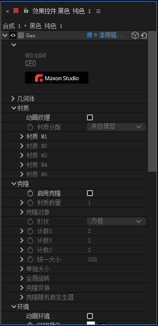
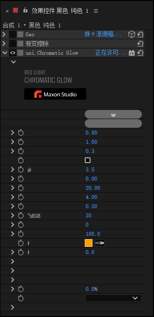
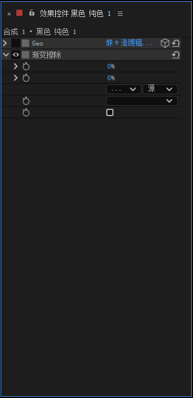
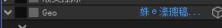

# AE 2027 Charset Fixer

**English** · [简体中文](README.md)

> Restores correct Chinese parameter names for Maxon / Trapcode effects in **After Effects 2027**, byte-for-byte identical to what AE 2026 shows.

Current version **v1.1.0** (adds BCC support — see [docs/CHANGELOG.md](docs/CHANGELOG.md)). The whole product is a single file: **`dist/!00_AE27CharsetFixer.aex`**. Copy it into AE 27's `Plug-ins` folder. No network access, no registry writes, no modification of any plugin binary.

---

## 1. The problem

AE 2027 assigns every effect module one of two text encodings:

| Module type | What AE 27 does | If the module ships |
|---|---|---|
| legacy | converts the module's **ANSI** bytes to UTF-8 | **UTF-8** text → mojibake (`钂欑増`, `鐎瑰簲`) |
| modern | treats the module's bytes as **UTF-8** verbatim | **ANSI / GBK** text → truncated, blank, half-characters |

That is why the same machine shows contradictory symptoms:

- localised ("汉化") plugins ship GBK and are legacy → AE converts for them → **they look fine**;
- Trapcode Geo / Form / Particular ship UTF-8 and are legacy → converted twice → **mojibake**;
- Trapcode Shine / Starglow / 3DStroke / SoundKeys ship GBK and are modern → nobody converts → **truncated**.

A "GBK → UTF-8 fixer" therefore makes things *worse* in AE 27: the direction is wrong.

### Screenshots

| Image | What it shows |
|---|---|
|  | **After the fix**: Geo's parameters are readable Chinese (`几何体` `材质` `克隆` `计数X` …). The blue text at the top right is Maxon's licensing link, not a parameter name — see [§8](#8-known-limitations) |
|  | **Wrong direction / allow-list too broad**: every parameter label is blank, only values remain (`0.80`, `1.00`, `0.3` …) |
|  | The same mistake also hits Adobe's own effects |
|  | The blue link enlarged: clicking it launches the Maxon App. Drawn by Maxon's runtime, not a `PF_ParamDef`, out of reach for a plugin |

Before → after (measured against AE 26 as the reference):

| Parameter | AE 27 before | AE 27 after | AE 26 |
|---|---|---|---|
| `几何体` | `鐎瑰簲`-style mojibake | `几何体` | `几何体` |
| `通道` (SoundKeys) | `ͨ` (truncated) | `通道` | `通道` |
| `预设` (Shine) | `Ԥ` (truncated) | `预设` | `预设` |
| all Universe parameters | blank | `阈值` `辉光半径` `半径X` … | same |

## 2. What the plugin does

An AEGP plugin that, at startup, hooks the `EntryPointFunc` / `EffectMain` / `PluginMain` export of every **allow-listed** module and converts its parameter strings once, in the direction that module needs:

```
legacy + UTF-8 text  ->  UTF-8 -> ANSI   (Trapcode Geo/Form/Particular/Tao/Mir/Lux/Echospace/Horizon, all of BCC)
modern + ANSI text   ->  ANSI  -> UTF-8  (Shine / Starglow / 3DStroke / SoundKeys)
everything else      ->  not touched at all
```

Three guard rails:

1. **Module allow-list** — only modules in the table are hooked. Adobe's own effects, Boris, Sapphire, Universe, localised plugins: never hooked, never converted.
2. **Thread-local scope gate** — `add_param` / `PF_UpdateParamUI` are host-wide, so the hooks only act while an allow-listed module's own entry point is running.
3. **Give up rather than mangle** — the UTF-8 → ANSI path uses `WC_NO_BEST_FIT_CHARS`; if any character is unrepresentable the whole string is left untouched. No question marks, ever.

## 3. Install

1. Quit After Effects 2027 completely.
2. Copy `!00_AE27CharsetFixer.aex` into:

   ```
   <AE 2027 install>\Support Files\Plug-ins\
   ```

   e.g. `E:\AE\Adobe After Effects 2027\Support Files\Plug-ins\`
3. Start AE 27.

The `!00_` prefix only makes it load early; it is not required.

**Uninstall**: delete the `.aex` and restart. Nothing else is left behind.

**Do not install on AE 2026** — 26 is a UTF-8 host and needs the opposite direction ([AE-UTF-8-Fixer](https://github.com/AdoreLowen/AE-UTF8-Fixer)). This plugin would break Chinese there.

## 4. Verification

The same probe script runs in AE 26 and AE 27; every effect's `property(i).name` is dumped and diffed.

| Effects | Parameters | Differences |
|---|---|---|
| Trapcode Geo / Form / Particular | 422 / 3022 / 2008 | 0 / 0 / 0 |
| Trapcode Tao / Mir / Lux / SoundKeys / Echospace / Horizon | 288 / 169 / 32 / 68 / 28 / 75 | all 0 |
| Trapcode 3DStroke / Shine / Starglow | 94 / 61 / 71 | 0 / 0 / 0 |
| Adobe Gradient Wipe / Linear Wipe | 9 / 7 | 0 / 0 |
| Red Giant VFX Bang · MB Looks / Colorista · Universe | 96 / 9 / 52 / 56 | all 0 |
| Boris BCC Blur · Sapphire S_Glow | 90 / 58 | 0 / 0 |
| PluginEverything Deep Glow 2 · Aquon (localised) | 162 / 45 | 0 / 0 |

**22 effects, ~6900 parameter names, zero differences.** Method and counter-examples: [`docs/VERIFICATION.md`](docs/VERIFICATION.md), tools in [`tools/`](tools).

## 5. External rules file (no rebuild needed for new vendors)

Drop a `AECharsetFixer.rules.txt` next to the `.aex` and restart AE:

```
# one rule per line: direction + path fragment (lower-cased, substring match)
U2A \somevendor\legacyeffects      # legacy module that ships UTF-8 text
G2U \somevendor\moderneffects      # modern module that ships ANSI text
```

Precedence: environment variables > rules file > built-in table.

How to classify a vendor: run `tools/family_probe.jsx` in AE 26 and AE 27 and diff.

| What AE 27 shows | Meaning | Rule |
|---|---|---|
| `鏁堟灉`-style gibberish (UTF-8 read as GBK) | legacy module, ships UTF-8 | `U2A` |
| labels truncated / blank, correct in 26 | modern module, ships ANSI | `G2U` |
| identical to 26 | nothing to do | none |

BCC was added this way: AE 26 correct, AE 27 shows `鏁堟灉棰勮...`, and all 1473 Chinese names are representable in CP936 → the whole folder is `U2A`.
## 6. Environment overrides

```powershell
# make a legacy module go UTF-8 -> ANSI
$env:AEUTF8FIXER_ANSI = '\trapcode\geo;\rowbyte\aura'
# make a modern module go ANSI -> UTF-8
$env:AEUTF8FIXER_GBK  = '\trapcode\shine'
```

Fragments are lower-cased and matched as substrings, separated by `;`.

Diagnostics (off by default):

```powershell
$env:AEUTF8FIXER_LOG = '1'      # writes %TEMP%\AECharsetFixer.log
```

## 7. Build from source

Two external dependencies, either in `third_party/` or via environment variables:

| Variable | Content |
|---|---|
| `AE_SDK` | After Effects SDK (`Headers/`, `Util/`, `Resources/PiPLtool.exe`) |
| `MINHOOK_DIR` | [MinHook](https://github.com/TsudaKageyu/minhook) source tree |

```bat
git clone https://github.com/TsudaKageyu/minhook third_party\minhook
set AE_SDK=D:\ae_sdk
build\build.cmd
```

Output: `dist\!00_AE27CharsetFixer.aex`. MinHook is rebuilt with `/MT` to avoid the runtime-library mismatch.

## 8. Known limitations

- Only **parameter strings** are handled (names, popup items, checkbox labels, slider descriptions). Maxon's unlicensed blue link is drawn by their runtime and is out of reach — license the plugin and it disappears.
- If a plugin passes names to AE only at module load (`PF_Cmd_PARAMS_SETUP`) *and* loads after this plugin, those names cannot be fixed (AE loads AEGPs after effect plugins). Measured: not an issue for any module in the table.
- The allow-list matches module paths; future folder renames in the Red Giant installers require updating `kRules` in `src/FixerANSI.cpp`.

## 9. Licence and credits

- This project: MIT (see [LICENSE](LICENSE))
- Derived from [AdoreLowen/AE-UTF8-Fixer](https://github.com/AdoreLowen/AE-UTF8-Fixer) (MIT) — AEGP hook skeleton and parameter walk
- [MinHook](https://github.com/TsudaKageyu/minhook) (BSD 2-Clause), statically linked
- AE SDK headers are not redistributed here


