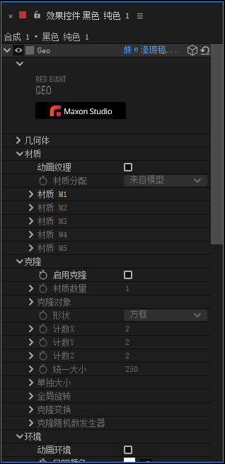
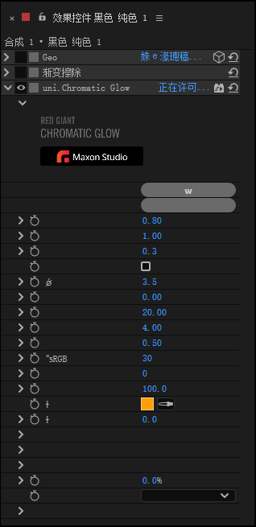
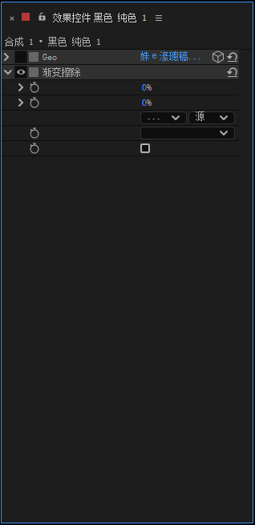
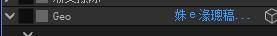

# AE 2027 中文乱码修复器 · AE27 Charset Fixer

**简体中文** · [English](README.en.md)

> 让 After Effects **2027** 里红巨星（Maxon / Trapcode）效果的中文参数名，恢复成和 **AE 2026** 一模一样。

产物只有一个文件：**`dist/!00_AE27CharsetFixer.aex`**。拷进 AE 27 的 `Plug-ins` 目录即可，不联网、不写注册表、不改任何插件文件。

---

## 1. 问题是什么

AE 27 给每个插件模块分配了**两种**文本编码模式之一：

| 模块类型 | AE 27 的处理 | 插件如果自带 |
|---|---|---|
| 老式模块（legacy） | 把插件的 **ANSI 字节**转成 UTF-8 | UTF-8 文本 → **显示成乱码**（`钂欑増`、`鐎瑰簲`） |
| 新式模块（modern） | 直接把字节当 **UTF-8** 用 | ANSI/GBK 文本 → **截断、空白或半个字** |

所以同一台机器上会出现很矛盾的现象：

- 汉化插件（Aquon、Deep Glow 2 等，GBK + 老式）在 27 里**正常**——AE 自己帮它转了一次；
- Trapcode Geo / Form / Particular（UTF-8 + 老式）在 27 里**乱码**——被多转了一次；
- Trapcode Shine / Starglow / 3DStroke / SoundKeys（GBK + 新式）在 27 里**残缺**——没人帮它转。

这也是为什么"装一个 GBK→UTF-8 的修复插件"反而会把事情弄得更糟：方向搞反了。

### 症状实拍

| 截图 | 说明 |
|---|---|
|  | **修复后的样子**：Geo 的参数名是正常中文（`几何体` `材质` `克隆` `计数X` …）。右上角那串蓝色小字是 Maxon 的授权提示链接，不属于参数名，见[第 7 节](#7-已知限制) |
|  | **方向搞反 / 白名单太宽时**：参数名整排空白，只剩数值（`0.80`、`1.00`、`0.3`…），根本不知道在调什么 |
|  | 同一个错误也会波及 Adobe 自带效果，连"渐变擦除"都变得没法用 |
|  | 放大看那串蓝色链接：点它会启动 Maxon App 授权。它由 Maxon 运行库绘制，不走 `PF_ParamDef`，插件层够不到 |

对照数据（修复前 → 修复后，取自 AE 26 基准比对）：

| 参数 | 修复前 AE 27 | 修复后 AE 27 | AE 26 |
|---|---|---|---|
| `几何体` | `鐎瑰簲` 类乱码 | `几何体` | `几何体` |
| `通道`（SoundKeys） | `ͨ`（截断） | `通道` | `通道` |
| `预设`（Shine） | `Ԥ`（截断） | `预设` | `预设` |
| Universe 全部参数 | 空白 | `阈值` `辉光半径` `半径X` … | 同左 |

## 2. 这个插件做什么

一个 AEGP 插件，在 AE 启动时挂钩每个**白名单模块**的 `EntryPointFunc` / `EffectMain`，在该模块自己的调用链里把参数字符串按需要的方向转一次：

```
老式 + UTF-8 文本   →   UTF-8 → ANSI     （Geo / Form / Particular / Tao / Mir / Lux / Echospace / Horizon）
新式 + ANSI 文本    →   ANSI  → UTF-8    （Shine / Starglow / 3DStroke / SoundKeys）
其它模块            →   完全不碰
```

三条安全边界：

1. **模块级白名单**：只有表里的模块会被挂钩，其余模块（Adobe 自带、Boris、Sapphire、Universe、汉化插件……）一律不钩、不转；
2. **线程局部作用域门**：AE 的 `add_param` / `PF_UpdateParamUI` 是全局接口，钩子只在"白名单模块自己的入口函数正在执行"时才动手，别的插件调用同一接口不会被波及；
3. **不可表示就放弃**：UTF-8 → ANSI 走 `WC_NO_BEST_FIT_CHARS`，任何字符映射不了就整串不动，绝不写问号。

## 3. 安装

1. 完全退出 After Effects 2027；
2. 把 `!00_AE27CharsetFixer.aex` 复制到：

   ```
   <AE 2027 安装目录>\Support Files\Plug-ins\
   ```

   例如 `E:\AE\Adobe After Effects 2027\Support Files\Plug-ins\`；
3. 启动 AE 27。

文件名前面的 `!00_` 只是让它尽早加载，不是必须的。

### 卸载

删掉那个 `.aex`，重启 AE。没有任何残留（不写注册表、不写配置文件）。

### 不要装在 AE 2026 上

AE 2026 是 UTF-8 宿主，用原版 [AE-UTF8-Fixer](https://github.com/AdoreLowen/AE-UTF8-Fixer)（GBK→UTF-8 方向）。本插件方向相反，装到 26 上会把中文又弄乱。

## 4. 验证结果

用同一份探针脚本在 **AE 26** 和 **AE 27** 里各跑一遍，枚举每个效果的 `property(i).name` 并逐条比对（26 为基准）：

| 效果 | 参数数 | 差异 |
|---|---|---|
| Trapcode Geo / Form / Particular | 422 / 3022 / 2008 | 0 / 0 / 0 |
| Trapcode Tao / Mir / Lux / SoundKeys / Echospace / Horizon | 288 / 169 / 32 / 68 / 28 / 75 | 全部 0 |
| Trapcode 3DStroke / Shine / Starglow | 94 / 61 / 71 | 0 / 0 / 0 |
| Adobe Gradient Wipe / Linear Wipe | 9 / 7 | 0 / 0 |
| Red Giant VFX Bang · MB Looks / Colorista · Universe | 96 / 9 / 52 / 56 | 全部 0 |
| Boris BCC Blur · Sapphire S_Glow | 90 / 58 | 0 / 0 |
| PluginEverything Deep Glow 2 · Aquon（汉化） | 162 / 45 | 0 / 0 |

**22 个效果、约 6900 个参数名，0 处差异。** 复现方法见 [`tools/`](tools) 与 [`docs/VERIFICATION.md`](docs/VERIFICATION.md)。

## 5. 环境变量（可选）

需要覆盖白名单里的模块时，启动 AE 前设置：

```powershell
# 让某个"老式"模块走 UTF-8 -> ANSI
$env:AEUTF8FIXER_ANSI = '\trapcode\geo;\rowbyte\aura'
# 让某个"新式"模块走 ANSI -> UTF-8
$env:AEUTF8FIXER_GBK  = '\trapcode\shine'
```

路径片段会被转成小写后做子串匹配，用 `;` 分隔。

排查日志（默认关闭）：

```powershell
$env:AEUTF8FIXER_LOG = '1'      # 写 %TEMP%\AECharsetFixer.log
```

## 6. 从源码构建

依赖两样外部资源，放到 `third_party/` 或设置环境变量：

| 变量 | 内容 |
|---|---|
| `AE_SDK` | After Effects SDK（`Headers/`、`Util/`、`Resources/PiPLtool.exe`） |
| `MINHOOK_DIR` | [MinHook](https://github.com/TsudaKageyu/minhook) 源码树 |

```bat
git clone https://github.com/TsudaKageyu/minhook third_party\minhook
set AE_SDK=D:\ae_sdk
build\build.cmd
```

产物在 `dist\!00_AE27CharsetFixer.aex`。MinHook 会用 `/MT` 单独编一份，避免与 `/MD` 运行库冲突。

## 7. 已知限制

- **只处理参数名/弹窗项/复选项名/滑块描述**。红巨星"未授权"的蓝色链接文字（点它启动 Maxon App）由 Maxon 运行库绘制，不走 PF 参数，本插件够不到——把授权弄正常它就不显示了；
- 若某个插件名只在**模块加载时**（`PF_Cmd_PARAMS_SETUP`）传给 AE，而本插件加载得更晚，那部分名字无法补转（AE 的 AEGP 总在效果插件之后加载）；对表格里的模块实测没有这个问题；
- 白名单是"按模块路径"的，红巨星以后改目录结构需要更新 `src/FixerANSI.cpp` 里的 `kRules`。

## 8. 许可与致谢

- 本项目：MIT（见 [LICENSE](LICENSE)）
- 派生自 [AdoreLowen/AE-UTF8-Fixer](https://github.com/AdoreLowen/AE-UTF8-Fixer)（MIT），复用了其 AEGP 挂钩骨架与参数结构定义
- [MinHook](https://github.com/TsudaKageyu/minhook)（BSD 2-Clause），静态链接
- After Effects SDK 头文件不随本仓库分发，请自行从 Adobe 获取


